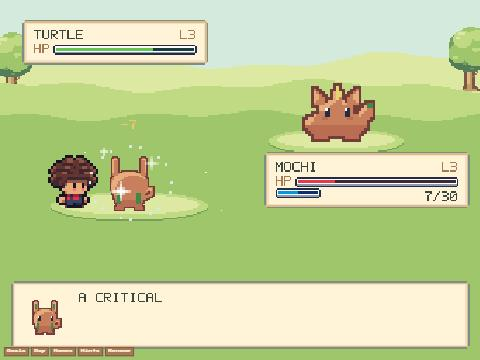
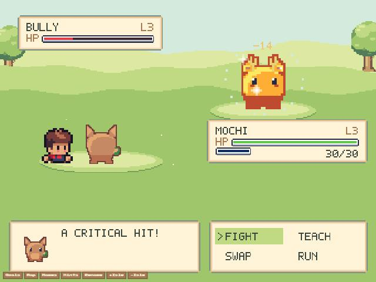

# Pack bars and glint on the battle screen (2026-11-03, live build main-OQm_PqE6, worker 6bdb78ea)

**Live, wild Turtle** (pane hidden, fresh frame via `__px.update`): "Turtle lands a HEAVY hit! A critical hit!" Three
pack glints pop around Mochi; Mochi's HP bar is the pack's red bar (7/30, under 40%), the Turtle's the green one (28/40),
and the signature charge is the blue bar, half full (1 of 2 blocks). 

**Local dev, a crit on a Bully:** red bar at 26% (hurt: befriending works far better), glints around the foe, my green
bar and an empty blue charge bar. 
