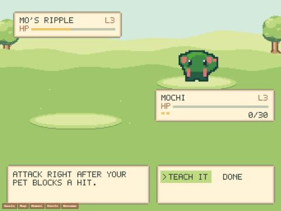
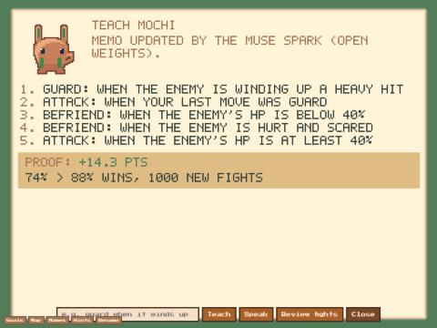

# Coach review after a fight (2026-11-03, live build main-CKR3gYL-, worker 973186f7)

Driven from the Browser pane on pets.uryto.dev (pane hidden, so `battleView.update` by hand). Game hour ~18.6.
Memo for the test: one rule, guard heavy (the profile's own 3-rule memo was saved and restored after).

**Mo, "Mo, wanna duel?"** (the rival kept its own style: the player would lose anyway):
```
Mo sends out Ripple!
Mo studies how your pet fights...
Mo: "Ripple, just be yourself!"
Mochi: braces and guards.
...
Mochi is out of breath...
Ripple strikes right after it guards, with a HEAVY hit.
Coach: Mochi blocked a hit but did not strike back once.
Coach: one lesson wins 28% of practice fights against Ripple, not 0%:
[Attack right after your pet blocks a hit.]  > TEACH IT   DONE
```


**Teach it** opened Teach with the lesson typed in; Enter sent it to the live coach. Muse Spark (open weights) answered
in 4.5 s with the counter rule (`last: guard -> attack`, "Counter-attack right after blocking as taught.") plus its own
extra rules. Proof: **+14.3 pts, 74% > 88% wins, 1000 new fights.**


Local dev, same build, wild Bully, empty memo: "Coach: Bully was hurt, but Mochi never tried to make friends." ->
"one lesson wins 53% of practice fights against Bully, not 6%" -> "Make friends when the foe's HP is below 40%." ->
Teach it -> no worker, so the offline coach taught it: `enemyHp < 40 -> befriend`, Proof +27.0 pts (59% > 86%).

Spend after: $0.39 of the $30 day cap.
