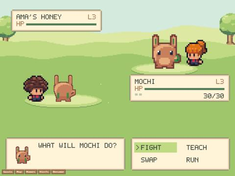
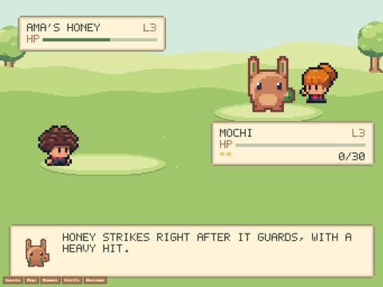
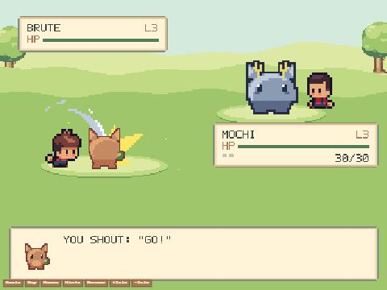

# Trainers on the battle screen (2026-11-03, live build main-R92c8Tcb, worker 26730c70)

Browser pane on pets.uryto.dev, pane hidden: `__px.update(0.01, performance.now() / 1000)` draws a fresh frame before
each screenshot (without it the shot is a stale frame with no trainers).

- **Ama's Honey duel, command menu:** Ama (long orange hair, the same look as in the village) stands behind Honey,
  facing left; the player (curly hair, from the pet's genes as in the village) beside Mochi, facing right.
  
- **End of the duel (Honey won):** Ama plays the jump strip (loop), the player's trainer the hurt flinch, then idle.
  
- **Shout (local dev, same code):** "You shout: Go!" plays the attack swing without the tools layer (no sword): an arm
  swing with the pack's swoosh. 

Unit tests: `pixel/battle.test.ts` (shout -> attack, heavy hit -> hurt -> idle, win -> jump), `pixel/humans.test.ts`
(ships exactly the strips any renderer can pick, battle trainers included).
